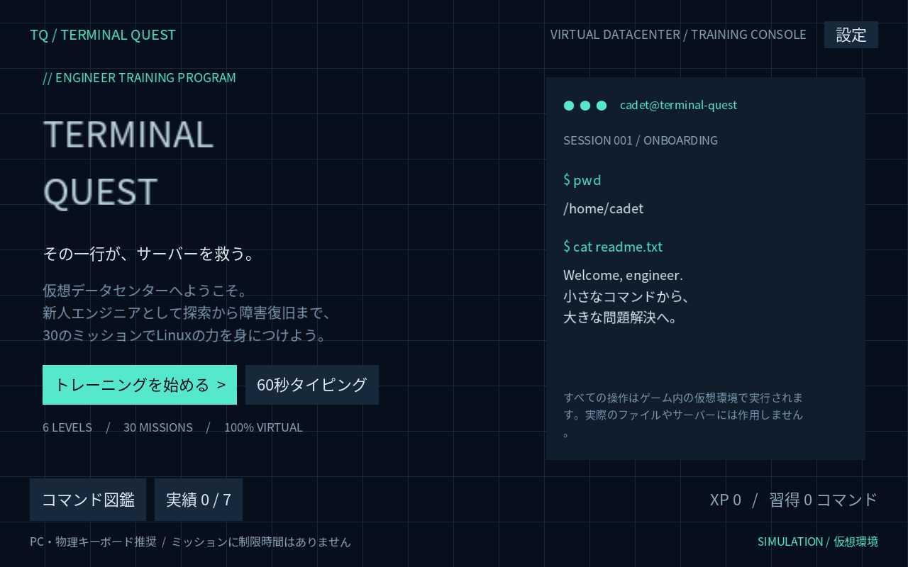

# TERMINAL QUEST

Linuxコマンドを使って仮想データセンターの問題を解決する、PCブラウザ向け学習ゲームです。探索、ファイル管理、ログ調査、パイプライン、サーバー運用、障害復旧を、6レベル・30ミッションで学びます。Javaのゲーム本体をlibGDXで描画し、LWJGL3版とHTML5/GWT版で共有しています。

**ゲームに入力したコマンドは、すべてメモリ内の仮想Linuxで処理します。** 実際のOS、ファイル、プロセス、サービス、ネットワークには渡しません。バックエンドやデータベース、APIキーは不要です。



## 起動

必要なものはJDK 21です。Gradleは同梱のWrapperを使います。最初のビルドではMaven Central、Gradle配布サーバーへのアクセスが必要です。

```bash
# リポジトリのルートで実行
./gradlew core:test

# PC版：ウィンドウが開きます
./gradlew lwjgl3:run

# Web版：静的ファイルを生成してHTTPサーバーで開きます
./gradlew html:dist
python3 -m http.server 8080 --directory html/build/dist
```

Web版をHTTPサーバーの `index.html` から開いてください。`file://` ではGWTのアセット読み込みが動作しません。ブラウザにはJavaプラグイン不要ですが、JavaScriptとWebGLが必要です。キーボードのあるPCを推奨します。小さい画面ではPC推奨の案内を表示します。

```bash
# 配布物
./gradlew lwjgl3:jar html:distZip
java -jar lwjgl3/build/libs/terminal-quest-desktop-1.0.0.jar
```

Web配布物は `html/build/dist/`、そのZIPは `html/build/terminal-quest-web.zip` です。PC版はディスプレイとOpenGLを利用できる環境で起動してください。macOSでは `-XstartOnFirstThread` が必要です（Gradleの `run` は自動設定）。

このCodexクラウド環境では、各シェルで先に `source tools/cloud-env.sh` を実行すると、用意したJDK・Gradleキャッシュ・Java用プロキシ設定を利用できます。環境を作り直す場合は `bash tools/cloud-setup.sh` でJDKのチェックサム検証、依存取得、テスト、PC／Webビルドを再実行します。これらの補助スクリプトは `/workspace/TERMINAL_QUEST` 用です。通常のPCではインストール済みJDK 21とWrapperだけで構いません。

## 遊び方

1. 「トレーニングを始める」からLEVEL 1の通常ミッションを選びます。
2. 右側の目標を読み、中央のターミナルへコマンドを入力します。最初のミッションは `pwd` です。
3. Enterまたは「実行」で操作します。↑／↓で入力履歴、←／→でカーソルを移動できます。Backspaceで削除できます。
4. 失敗したら出力を読み、必要に応じてヒント・コマンド図鑑を使います。「ターミナルに戻る」で入力フォーカスを戻せます。
5. 目標達成後の結果画面で、ランク・エラー・ヒント・時間・使用コマンド・新しく習得したコマンドを確認できます。

ミッションには制限時間がありません。通常ミッション4つをクリアすると、そのレベルのボスが解放されます。ボスをクリアすると次のレベルが解放されます。クリア済みミッションは再挑戦できます。再挑戦でXPが重複加算されることはありません。

| レベル | 分類・テーマ | 主な学習内容 | ミッション数 |
| --- | --- | --- | --- |
| 1 | 初学者Ⅰ：入門・探索訓練 | `pwd`、`ls`、`cd`、相対／絶対パス | 5 |
| 2 | 初学者Ⅱ：基礎・ファイル管理 | `cat`、`touch`、`mkdir`、`cp`、`mv` | 5 |
| 3 | 中級者Ⅰ：実践・ログ調査 | `grep`、`find`、`head`、`tail`、`wc` | 5 |
| 4 | 中級者Ⅱ：応用・コマンド連携 | `|`、`>`、`>>`、`sort`、`uniq` | 5 |
| 5 | 上級者Ⅰ：運用・サーバー管理 | `chmod`、`ps`、`kill`、`df`、`du` | 5 |
| 6 | 上級者Ⅱ：達人・障害復旧 | `systemctl`、`journalctl`、複合障害 | 5 |

各ミッションを始めるたび、仮想サーバーをシナリオの初期状態へ戻します。ファイル変更は別ミッションやブラウザ再読み込みには引き継ぎません。最終ボスは設定権限・巨大ログ・暴走プロセスを調査してWebサービスを復旧する課題で、決まった入力文字列や操作順ではなく、仮想サービスの正常稼働を判定します。

### ヒントと評価

初学者には操作例を最初から表示します。中級者以上は目標から調査方法を考え、任意で3段階のヒントを開けます。例や図鑑を読んで、自分のペースで試せます。

ランクは `system/RankConfig.java` のしきい値で調整できます。標準設定は次のとおりです。

| ランク | 条件 |
| --- | --- |
| C | エラー6回以上、またはコマンド40回以上 |
| B | 上記に該当せず、追加ヒントを使用 |
| S | 追加ヒントなし、エラー0回、コマンド12回以下、180秒以内 |
| A | それ以外の達成 |

どのランクでもクリアと解放条件は同じです。速さやヒント使用で学習の継続を妨げません。

初クリア、探索修了、ファイル管理、ログ分析、障害復旧、全30ミッション、タイピング10問の全7実績があります。タイトル画面の「実績」から確認できます。実績は保存済みの進捗から復元します。

### 60秒タイピング

ミッションで習得したコマンドを使う、独立した練習モードです。6段階から教材を選び、習得済みのコマンドとパイプ・出力機能だけを含むお題を出します。上位ほど引数・オプション・パイプを含む長いコマンドになります。出題できるお題がまだないレベルでは開始ボタンが無効になり、先にミッションで習得するよう案内します。

表示された文字列を正確に入力し、Enterで送信します。ゲーム内でコマンドは実行されません。

- 完成コマンド数、正確率、KPM、最大コンボを表示します。
- 正確率は送信した文字列とお題の同じ位置の一致文字数を、お題と入力の長い方の文字数で割った値です。短すぎる入力も誤りとして集計します。
- KPMは送信した総文字数を経過分数で割ります。Backspace等の物理キー押下回数ではありません。
- 誤入力でコンボが切れ、お題はそのままです。60秒経過後は送信を受け付けません。
- レベル別の完成コマンド数の自己ベストと、そのときの正確率・KPM・最大コンボを保存します。ミッションのランクや解放条件には影響しません。

### セーブ・設定

libGDX Preferencesへ、バージョン、クリア済みミッション、最高ランク、XP、コマンド習熟度、タイピング自己ベスト、音量・ミュート・演出軽減を保存します。レベルの解放はクリア履歴から復元します。

Web版の保存先は同じブラウザ・同じオリジンのローカルストレージです。PC版とは共有しません。サイトデータを削除すると記録も失われます。設定のセーブリセットは確認画面を経由します。不正なバージョンや破損した値は安全な初期状態へ戻します。プライベートブラウズ等で保存が禁止された場合も、メモリ内でプレイを継続します。

## 仮想シェルの対応範囲

フル機能のBashではありません。`help` とゲーム内図鑑でも対応構文を確認できます。

| コマンド | 主な対応形式 |
| --- | --- |
| `pwd`、`cd` | 現在地の表示／移動。`.`、`..`、絶対パス、`~`に対応 |
| `ls` | `-l`、`-a`、`-la`、対象パス |
| `cat`、`touch` | 複数ファイル。`cat -`はパイプからの標準入力 |
| `mkdir` | ディレクトリ作成、`-p` |
| `cp`、`mv` | コピー元・移動元と移動先。`cp -r`／`-R`は再帰コピー |
| `grep` | 文字列検索、`-n`、`-i`。正規表現ではありません |
| `find` | 開始パス、`-name`の名前パターン、`-type f`／`d` |
| `head`、`tail` | 標準入力／ファイルの先頭・末尾。`-n 行数`、既定10行 |
| `wc` | `-l`、`-w`、`-c`。文字数ではなくUTF-8のバイト数を `-c` に表示 |
| `sort`、`uniq` | 行の辞書順、`sort -r`／`-u`、隣接重複除去、`uniq -c` |
| `chmod` | `644`のような000〜777の数値モード |
| `ps`、`kill` | 仮想プロセス。`ps aux`／`-ef`、`kill [-9|-15] PID` |
| `df`、`du` | 仮想容量。`-h`、`du -a`／`-s`／`-ah`／`-sh` |
| `systemctl` | 仮想 `web` サービスの `status`／`start`／`restart`／`stop` |
| `journalctl` | 仮想サービスログ、`-u web` |
| `echo`、`clear`、`help` | テキスト出力（`echo -n`）、表示消去、対応範囲の表示 |

引用符・バックスラッシュのエスケープを扱い、`|`で前段の標準出力を後段の標準入力へ渡します。`>`で仮想ファイルに上書き、`>>`で追記します。出力先はパイプラインの末尾に1つだけ指定できます。

```text
grep ERROR logs/app.log | head -n 3 > errors.txt
sort data/hosts.txt | uniq -c > host-counts.txt
cat /dev/null > /var/log/archive.log
```

`&&`、`;`、`&`、入力リダイレクト、変数展開、コマンド置換、サブシェル、スクリプト、実行ファイルの起動は未対応です。シェルのワイルドカード展開は行わず、`find -name '*.log'`のような名前検索の中だけで扱います。引用符の中の記号は文字列です。未対応コマンド、引数、存在しないパス、読み書きできない権限はエラーとして返します。

学習用のため、権限は読み取り・書き込み・探索可否の簡略モデルです。各種類の権限ビットが1つでもあれば利用可能とし、所有者／グループは区別しません。配下へのアクセスには祖先ディレクトリの探索権限を、新しい項目の作成と移動には親ディレクトリの書き込み・探索権限を確認します。探索可能な読み取り専用ディレクトリでも、既存の書き込み可能ファイルは上書きできます。sudo、リンク、マウント、実際のプロセスシグナルやHTTPアクセスは再現しません。サービスの「HTTP 200」はシミュレーションのヘルス状態です。ログの巨大サイズは数値として保持し、950 MBの本文をメモリに確保しません。

暴走プロセスは仮想PID 42、保護対象は仮想PID 1です。ディスク容量は1,000,000,000バイトです。入力4096文字、パイプ16段、仮想エントリ2048件、1ファイルの本文・1回の出力は各1 Mi文字に制限します。ゲーム内の履歴表示にも長さ上限を設けています。

## 開発構成

```text
core/src/main/java/jp/terminalquest/
  game/       共有libGDXゲーム、リソース
  screen/     タイトル、レベル選択、ミッション、結果、タイピング、図鑑
  terminal/   パーサー、コマンド処理、仮想FS・プロセス・サービス
  mission/    6難易度・30ミッションのデータ、条件、評価、セッション
  system/     解放・XP・習熟、ランク、60秒タイピング
  save/       Preferences、設定、破損値の検証
core/src/test/ JUnitテスト
lwjgl3/       PC起動・実行可能JAR
html/         GWT起動、静的ページ、Webビルド
assets/       日本語ビットマップフォント、効果音
```

gdx-liftoffの `core`／`lwjgl3`／`html` 分離とGWTモジュール構成を参考にしています。小さなビルドを維持するため、GWTは外部Gradleプラグインを追加せず、Gradleの `JavaExec` タスクから公式コンパイラを呼び出します。

HTML側の `ModernGwtInput` は、現行Chromiumの標準 `wheel` イベントをlibGDXのスクロール入力へ橋渡しします。使用しているGWTバックエンドが従来の `mousewheel` を購読するために実操作テストで発生した問題への対応です。二重イベントを防ぎ、Scene2D側でもポインター下のスクロール領域へ入力を渡します。ターミナルのキーボードフォーカスは維持します。

| 要素 | 固定バージョン／設定 |
| --- | --- |
| 開発・ビルドJDK | 21 |
| ゲーム本体の言語・バイトコード | Java 8（`--release 8`） |
| Gradle Wrapper | 8.14.3、配布ZIPのSHA-256固定 |
| libGDX / LWJGL3 backend | 1.13.1 |
| GWT | 2.11.0、source level 1.8、2ワーカー |
| JUnit Jupiter | 5.11.4 |

GWTで使えないホストのファイル／プロセスAPIに依存しない設計です。日本語は実行時のFreeTypeに依存せず、同梱のBMFontアトラスをPC／Webで共用します。フォント等の帰属は `assets` 内のライセンスを参照してください。

表示文言に新しい文字を追加した場合は `python3 tools/generate_assets.py` でフォントと効果音を再生成できます。開発時だけPython 3、Pillow、Noto Sans CJK、DejaVu Sans Monoが必要です。フォントのパスはスクリプトの引数で変更できます。生成済みアセットを同梱しているため、通常のビルドにPythonやフォント生成ツールは不要です。

難易度は `DifficultyLevel`、ミッションは `MissionCatalog` のデータです。タイトル、目標、ヒント、XP、初期シナリオ、達成条件を追加すると、共通の画面・解放処理で利用できます。新しい種類の条件が必要な場合だけ `MissionCondition` を拡張します。

## テスト・ビルド確認

```bash
./gradlew core:test lwjgl3:jar html:dist --no-daemon
```

JUnitの結果は `core/build/reports/tests/test/index.html`、機械可読の結果は `core/build/test-results/test/` に出力します。テストはパーサー、仮想コマンド、パイプ・リダイレクト、ミッション達成・解放、保存復元、タイピング集計を対象とします。実ブラウザや描画の検証はJUnitとは区別します。

現在の実行結果は [検証記録](docs/validation.md) に記載します。操作チェックリストは [手動確認手順](docs/manual-test.md) を参照してください。未確認項目を合格として扱いません。

## GitHub Pages公開

`.github/workflows/verify.yml` はpush・pull requestでJUnit、PC JAR、Webビルドを確認します。`pages.yml` は `main` へのpushまたは手動実行で静的Web版をGitHub Pagesへ公開する構成です。

1. このプロジェクトをGitHubへプッシュします。
2. リポジトリの **Settings → Pages → Source** を **GitHub Actions** に設定します。
3. **Actions → Publish GitHub Pages → Run workflow** を実行します。

初回はリポジトリのPages設定が必要です。設定後は `main` へのpushごとに更新され、手動でも再実行できます。公開の成否と公開URLはActionsの実行結果で確認してください。外部CDNやAPIへの依存がない静的配信です。URLのサブディレクトリを含むPages配信は相対パスで扱います。

## 参照資料と適用範囲

| 資料 | 確認・適用した内容 |
| --- | --- |
| [libGDX](https://libgdx.com/)・[HTML5/GWT](https://libgdx.com/wiki/html5-backend-and-gwt-specifics) | 同梱バックエンドのソースとMaven配布物を確認し、Scene2D、GWTモジュール、アセットプリロードを使用。ドキュメントサイト本体は実行環境のネットワーク制限で未閲覧 |
| [gdx-liftoff](https://github.com/libgdx/gdx-liftoff) | 公式リポジトリの生成コードを確認。モジュール分離、Web起動・GWT設定の基礎に使用 |
| [GNU Coreutils](https://www.gnu.org/software/coreutils/manual/coreutils.html)・[GNU Bash](https://www.gnu.org/software/bash/manual/bash.html) | 標準入出力・パイプ・リダイレクトという学習概念を採用。オンラインマニュアルはネットワーク制限で未閲覧。完全なGNU互換は主張しません |
| [OpenAI Game UI Frontend](https://github.com/openai/plugins/blob/main/plugins/game-studio/skills/game-ui-frontend/SKILL.md) | 文書を閲覧。可読性、視覚的な優先順位、必要時に開く補助情報、控えめな演出を参考に採用。Scene2D指定のためDOM UI推奨は採用していません |
| [Emil Kowalski Skills](https://github.com/emilkowalski/skills) | READMEを閲覧。不要な動きの抑制と最悪ケースを確認する方針の参考。個別スキルは導入していません |
| [Game Accessibility Guidelines](https://gameaccessibilityguidelines.com/) | サイトはネットワーク制限で未閲覧。時間制限なしのミッション、任意のヒント、音量・ミュート・演出軽減を用意。アクセシビリティ監査完了は主張しません |
| [Kenney](https://kenney.nl/assets) | サイトはネットワーク制限で未閲覧。Kenney素材は使用していません |

PC向けキーボード操作と可読性を優先した初版です。スクリーンリーダー、ゲームパッド、スマートフォン専用操作、他ブラウザ・他OSの広範な互換性は今後の検証対象です。

## 次の実装候補

- 教材の追加：新しいログ調査・障害復旧シナリオと、達成後の解説。
- 学習支援：間違えやすい操作に合わせた復習問題と、進捗のエクスポート。
- 互換性・操作性：Firefox／Safari／各OSでの確認と、キーボード操作・アクセシビリティの改善。
